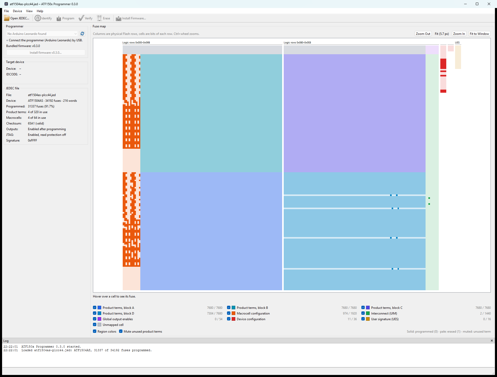
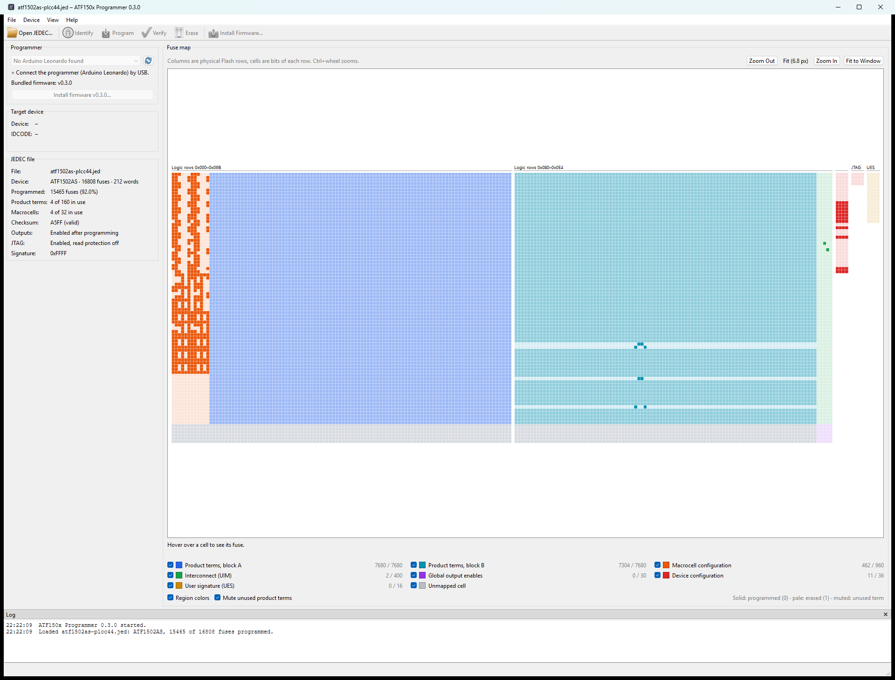
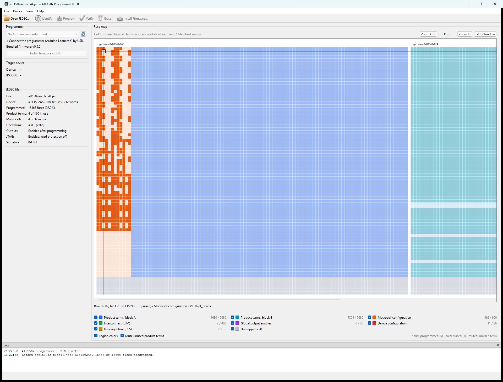

# ATF150x programmer

[](https://github.com/ifilot/atf150x-programmer/actions/workflows/build.yml)
[](https://github.com/ifilot/atf150x-programmer/releases)
[](LICENSE)

Program **ATF1502AS** and **ATF1504AS** chips with an Arduino Leonardo and a
small open-source adapter board, instead of the expensive ATDH1150USB
programmer and its vendor software.

These chips (CPLDs) hold a small digital-logic design that you create in a tool
such as WinCUPL. That tool produces a `.jed` file; this project writes that
file into the chip and checks that it arrived correctly.



## Contents

- [What you need](#what-you-need)
- [Download](#download)
- [Quick start (Windows)](#quick-start-windows)
- [The desktop application](#the-desktop-application)
- [Command line (Windows and Linux)](#command-line-windows-and-linux)
- [Troubleshooting](#troubleshooting)
- [Technical details](#technical-details)
- [License](#license)

## What you need

- **The adapter board** from [`pcb/atf150X-programmer`](pcb/atf150X-programmer),
  fitted on an **Arduino Leonardo**.
- **A 5 V ATF1502AS or ATF1504AS** in the PLCC-44 socket, with JTAG enabled.
- **A `.jed` file** for your design, for example made with WinCUPL.
- **A USB cable** and a Windows PC for the desktop application, or Windows or
  Linux for the command line.

Not supported: ATF1502ASV/BE and other low-voltage variants, other chip sizes,
several chips in one chain, and chips whose JTAG port has been switched off.

## Download

| What | Download (v0.3.0) |
| --- | --- |
| **Desktop application for Windows** (recommended) | [Installer](https://github.com/ifilot/atf150x-programmer/releases/download/v0.3.0/atf150x-programmer-v0.3.0-windows-x86_64-setup.exe) · [Portable zip](https://github.com/ifilot/atf150x-programmer/releases/download/v0.3.0/atf150x-programmer-v0.3.0-windows-x86_64.zip) |
| Command-line tool | [Windows](https://github.com/ifilot/atf150x-programmer/releases/download/v0.3.0/atfprog-v0.3.0-windows-x86_64.zip) · [Linux](https://github.com/ifilot/atf150x-programmer/releases/download/v0.3.0/atfprog-v0.3.0-linux-x86_64.tar.gz) |
| Arduino Leonardo firmware | [Firmware](https://github.com/ifilot/atf150x-programmer/releases/download/v0.3.0/atf1502-leonardo-firmware-v0.3.0.zip) (already included with the desktop application) |

Newer versions and checksums are on the [latest release
page](https://github.com/ifilot/atf150x-programmer/releases/latest).

## Quick start (Windows)

1. **Install** the desktop application with the installer above.
2. **Insert the chip** while the board is unplugged. Check the orientation.
3. **Plug in** the Arduino by USB and start **ATF150x Programmer**. It finds the
   programmer by itself. The first time, it offers to install the firmware on
   the Arduino: click **Yes**.
4. **Open** your `.jed` file with **Open JEDEC…** or by dragging it onto the
   window.
5. Click **Program**. The chip is erased, programmed and checked, which takes
   tens of seconds. Do not unplug the board while it runs.

The status bar and the log at the bottom tell you whether it succeeded.

## The desktop application

<table>
  <tr>
    <td width="50%"></td>
    <td width="50%"></td>
  </tr>
  <tr>
    <td>An ATF1502AS design, fitted to the window.</td>
    <td>Zoomed in; the cell under the mouse is described below the map.</td>
  </tr>
</table>

- **Program, Verify, Erase, Identify.** *Verify* compares the chip with the
  open file without changing it. *Identify* reports which chip is in the
  socket. If you rebuild the `.jed` file in WinCUPL, it is reloaded
  automatically before programming.
- **Fuse map.** Shows every memory cell of the chip, colored by what it does.
  Hover over a cell to see its meaning. The side panel summarizes the design:
  chip type, how much of the chip is used, and whether the checksum is valid.
- **Firmware updates.** If the Arduino runs an older or different program, the
  application offers to install the right firmware. The Arduino's bootloader
  is never changed.
- **Update notification.** At startup the application checks for a newer
  release; turn this off in the **Help** menu.

## Command line (Windows and Linux)

`atfprog` does the same as the desktop application from a terminal. Replace
`COM3` with your Arduino's port (on Linux, for example `/dev/ttyACM0`). In
Windows PowerShell, type `.\atfprog.exe` instead of `atfprog`.

```sh
atfprog inspect design.jed            # check the file; does not touch the chip
atfprog scan --port COM3              # identify the chip
atfprog flash design.jed --port COM3  # erase, program and check
atfprog verify design.jed --port COM3 # compare chip and file
atfprog erase --port COM3             # erase the chip
atfprog --help
```

`flash` checks the `.jed` file before it touches the chip, and switches the new
design on only after every bit has been read back and compared. If programming
is interrupted, reconnect and run `flash` again. A nonzero exit status means
the operation failed.

## Troubleshooting

- **"No Arduino Leonardo found" or the port is busy.** Close the Arduino IDE
  Serial Monitor and other programs using the port, then press the refresh
  button.
- **The chip reads as all zeros or all ones.** Check that the chip is seated the
  right way round, the board is assembled correctly and the chip is a 5 V
  ATF1502AS/ATF1504AS. A chip with JTAG switched off cannot be recovered with
  this programmer.
- **Linux: permission denied on `/dev/ttyACM0`.** Add your user to the serial
  group (usually `dialout`), then log out and in again.
- **Programming was interrupted.** Nothing is switched on until the design has
  been checked; simply program again.

## Technical details

- [Building from source](docs/BUILDING.md): firmware, command-line tool and
  desktop application.
- [Protocol and programming algorithm](docs/PROTOCOL.md): supported JEDEC
  records, fuse mapping, serial framing and safeguards.
- [Validation](docs/VALIDATION.md) on real hardware, including
  cross-checks with an official ATDH1150USB programmer, and matching
  [WinCUPL test designs](examples/logic_test/README.md).
- [Coding style](docs/STYLE.md) and
  [third-party attribution](docs/THIRD_PARTY.md).

<details>
<summary>Board pin assignments</summary>

| JTAG | Leonardo pin | Series resistor |
| --- | --- | --- |
| TDI | D2 | R3 |
| TCK | D3 | R4 |
| TDO | D4 | R5 |
| TMS | D12 | R6 |

The board uses ordinary GPIO pins, not the Leonardo's SPI header. Its `5V1` pin
supplies the `+5V` net. The firmware leaves the JTAG pins as inputs between
sessions and does not switch the chip's power. ATF1502AS reports IDCODE
`0x0150203F`; ATF1504AS reports `0x0150403F`.

</details>

## License

The software, firmware, tests, build configuration and documentation are
licensed under the GNU General Public License version 3 only
(`GPL-3.0-only`); see [LICENSE](LICENSE). Copyright (c) 2026 ATF1502 programmer
contributors. Required upstream notices are kept in
[third-party attribution](docs/THIRD_PARTY.md). The PCB files keep their
[CC BY-SA 4.0 license](pcb/atf150X-programmer/LICENSE).
